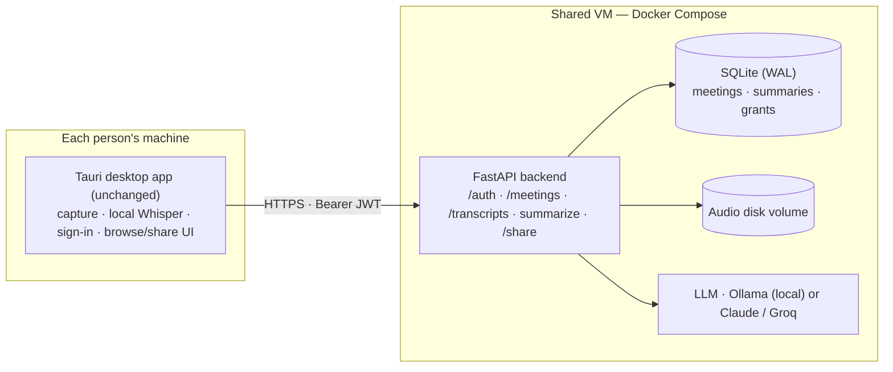
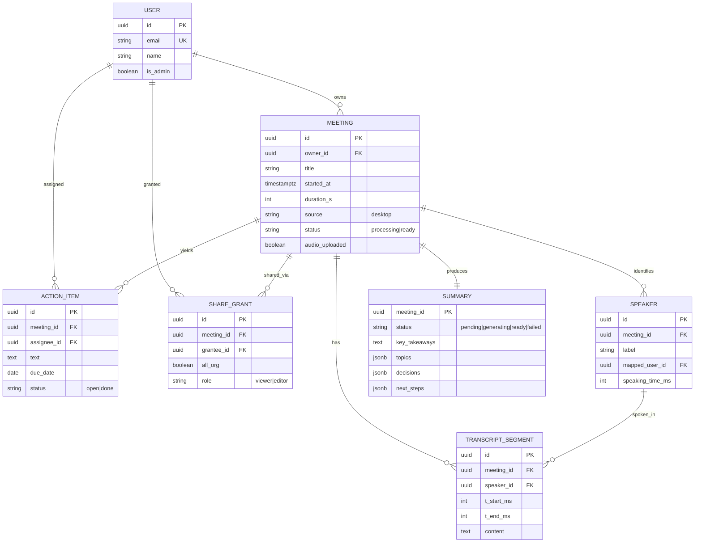
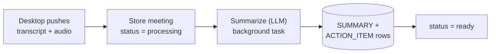

# Saransh — Backend Architecture (MVP)

**Source of intent:** [Meeting Summariser — Figma](https://www.figma.com/design/gFLPWa1todMUetoxrVmsdj/Meeting-summariser?node-id=0-1&m=dev)
**Scope:** MVP — internal to one org, Google **Internal** sign-in, desktop keeps recording, shared backend for storage / summaries / sharing, < 25 users
**Status:** Proposal / for review

---

## 1. MVP scope

We are **not** building the full multi-tenant platform yet. This MVP is deliberately the smallest thing that makes recordings shareable and summarized inside one org.

| In the MVP | Deferred (see §9, North star) |
|---|---|
| Google **Internal** sign-in (domain-restricted) | Multi-org tenancy, billing/plans |
| Desktop records + transcribes locally (unchanged) | Ask Saransh RAG chat, embeddings, pgvector |
| Shared backend: store meetings, transcripts, audio | Calendar/Meet auto-record bot |
| Server-side structured summary + action items | External invite-by-email, connectors |
| Browse in Library, share within the org | Redis/Celery queue, object storage at scale |

**Design principle carried forward:** privacy-first. Transcription stays on the client; the LLM can be local (Ollama on the VM) so no meeting content leaves your infrastructure.

---

## 2. Auth — the key simplification

Because everyone is in one Google Workspace org, auth is almost free:

1. In **Google Cloud Console → OAuth consent screen**, set **User type = Internal**. Only accounts in your Workspace domain can complete the flow — external Google accounts are rejected by Google itself, with no allow-list to maintain.
2. The **desktop app** signs in via **OAuth PKCE with a loopback redirect** (`http://127.0.0.1:<port>`), opening the system browser. It receives a Google **ID token**.
3. It posts that token to **`POST /auth/google`**. The backend verifies the token's **signature, `aud`, and `hd` (hosted-domain) claim** (`hd == yourcompany.com`) as defense-in-depth, upserts the `user`, and returns a **session JWT**.
4. Every later API call carries `Authorization: Bearer <jwt>`. Middleware validates it and resolves the current user.

That is the entire auth security model — no passwords, no external users, no per-user provisioning.

**Implemented contract (Task 1):**
- `POST /auth/google` → body `{ "id_token": "<google-id-token>" }` → returns `{ access_token, token_type: "bearer", user: { id, email, name, picture, is_admin } }`.
- `GET /auth/me` → returns the current `CurrentUser` (validates the session token). Used as the `get_current_user` FastAPI dependency elsewhere.
- **Env vars:** `GOOGLE_CLIENT_ID`, `ALLOWED_HOSTED_DOMAINS` (comma-separated; blank = allow any, for local testing only), `JWT_SECRET`, `JWT_EXP_HOURS` (default 168 = 7 days).
- **Session JWT:** HS256, claims `sub, email, name, is_admin, iat, exp`.
- **Libraries:** `PyJWT`, `google-auth` (`>=2.48.1` to satisfy the existing `google-genai`), `requests`.

**Decisions made during Task 1:**
- **First user to sign in is bootstrapped as admin** — guarantees at least one org administrator without manual seeding.
- **Domain restriction is a list** (`ALLOWED_HOSTED_DOMAINS`), not a single domain, to allow multi-domain Workspaces.
- **User identity** = internal `id` (`user-<uuid>`), with `google_sub` and `email` both unique; upsert matches on either.

---

## 3. System architecture

Desktop stays as-is; we add a **single shared backend**. At < 25 users this is one small VM.

**Why no Redis, no object store, no Postgres yet:** at this volume, summarization runs as a **FastAPI background task** in-process, audio sits on a **local disk volume** served through an authenticated download endpoint, and **SQLite in WAL mode** comfortably handles < 25 users' light, mostly-append writes while reusing the existing `DatabaseManager` in `backend/app/db.py`.

---

## 4. Data model (MVP)

No `org` table — the Workspace domain *is* the org. Seven small tables.

**Notes**
- **Action items are first-class rows** (assignee, due date, independent status) — the Detail Page toggles them without touching the summary.
- **Summary is a state machine** (`pending → generating → ready|failed`) backing the "Generating summary…" screen.
- Keep everything behind `DatabaseManager` so the **Postgres + pgvector** swap for phase 2 (RAG) is contained to the data layer.

---

## 5. Sharing model

Simple, no ACL engine:

- Meetings are **private to the owner** by default.
- The owner adds `share_grant` rows for **specific colleagues** (`viewer` / `editor`), or flips one **`all_org`** grant meaning "visible to everyone in the org".
- **Authorization filter on every read:** a user may see a meeting if they are the owner, **OR** a `share_grant` names them, **OR** an `all_org` grant exists. This single predicate lives in the data layer and is applied to every meeting/transcript/summary query.

This covers the Figma "Share recording" screen (invite people, roles) without external email or a policy engine.

---

## 6. Sync & summarize flow

- Desktop transcribes locally (existing), then calls the **ingest endpoints** with meeting metadata + transcript segments, and optionally the audio file.
- The backend stores the meeting `processing`, then a **background task** calls the LLM to produce a **schema-validated JSON** summary (takeaways / topics / decisions / next_steps / action_items) — never freeform prose parsed into UI — and flips the meeting to `ready`.

**Two defaults (override if you want):**
- **Summarize on the VM** (consistent model, central control) rather than on each desktop.
- **Always upload transcripts; audio optional per meeting** (saves disk/privacy; audio enables re-summarizing later).

---

## 7. Stack & deployment

| Concern | MVP choice | Why |
|---|---|---|
| API | **FastAPI** (keep) | Reuse existing backend, `main.py`, `db.py` |
| DB | **SQLite (WAL)** | Fine for < 25 users; zero migration now; swap to Postgres at RAG time |
| Async | **FastAPI background tasks** | No Redis/Celery needed at this volume |
| Audio | **Local disk volume** | Authenticated download endpoint + short-lived signed URL |
| Auth | **Google OAuth (Internal) + JWT** | Domain-restricted for free; sessions via JWT |
| LLM | **Ollama (local)** or hosted key | Provider abstraction already exists; local keeps data in-house |
| Deploy | **One VM · Docker Compose** | FastAPI container + disk volume (+ Ollama container if local) |
| Backup | **Copy SQLite file + audio dir** | Nightly cron; trivial restore |

---

## 8. Build order

1. **Auth** — `POST /auth/google` (verify ID token, `hd`), JWT session middleware, `user` table.
2. **Desktop sign-in** — PKCE + loopback flow; attach bearer token to existing API calls.
3. **Ingest** — meeting / transcript / audio endpoints; background summarize.
4. **Sharing** — `share_grant` + the read-authorization filter on every query.
5. **Read APIs** — Library list + meeting detail feeding the redesign screens.

---

## 9. North star (later phases)

The MVP is a strict subset of the full platform, chosen so nothing here blocks the path below.

- **Phase 2 — Ask Saransh (RAG):** switch SQLite → **Postgres + pgvector**, embed transcript chunks, add scoped streaming chat with citations back to `TRANSCRIPT_SEGMENT`. (Scope = the security boundary; retrieval is ACL-filtered.)
- **Phase 3 — Auto-record:** calendar/Meet bot service, recording consent flows.
- **Phase 4 — Beyond one org:** re-introduce an `org` table + `org_id` on every row, RBAC + external invite-by-email, object storage (S3/R2), Redis/Celery, connectors (Slack/Notion/Jira).

Keeping the data access behind `DatabaseManager` and the LLM behind the provider interface is what makes each of these an additive step rather than a rewrite.

---

## 10. Build log & decisions

This section is the living record of implementation progress against §8. Keep it in sync as each task lands.

| Task | Status | Notes |
|---|---|---|
| **1 · Auth** | ✅ Done | `POST /auth/google`, `GET /auth/me`, JWT middleware, `users` table. Smoke-tested (JWT round-trip, dependency 401s, upsert + admin bootstrap). |
| **3 · Ingest + summarize** | ✅ Done | `POST /api/meetings/ingest`, `POST/GET /api/meetings/{id}/audio`; meetings gain owner/status/audio columns; server-side summarize via configured model. E2E tested (ingest, audio up/down, cross-user 403, 404). |
| **4 · Sharing** | ✅ Done | `share_grants` table; `POST/GET/DELETE /api/meetings/{id}/share[s]`; access = owner OR grant OR all-org (admin = owner). Role-aware `_require_meeting_access(write=)`. Full matrix tested (viewer read-only, editor read+write, all-org, revoke, owner-only management, Library visibility). |
| **5 · Read APIs** | ✅ Done | `GET /api/meetings` (accessible + per-meeting role) and `GET /api/meetings/{id}` (metadata + role + transcript + structured summary). Access-filtered; tested incl. admin-sees-all + legacy endpoints intact. |
| 2 · Desktop sign-in | ⬜ Only remaining task | PKCE + loopback in the Tauri app; exchange for session JWT; attach bearer to `/api/*` calls. **Client-side Rust/Next (D6).** Google client id/secret + domain configured in `backend/.env`. |

**Backend MVP status: complete.** Tasks 1, 3, 4, 5 shipped and tested end-to-end. Only the desktop sign-in wiring (Task 2) remains, plus optional hardening (below).

**Files touched — Task 1:** `backend/app/auth.py` (new), `backend/app/db.py` (`users` table + `upsert_user`/`get_user_by_id`), `backend/app/main.py` (auth imports + endpoints), `backend/requirements.txt`, `backend/temp.env`.
**Files touched — Task 3:** `backend/app/db.py` (meetings ownership/status columns + `create_owned_meeting`/`add_meeting_segments`/`set_meeting_status`/`set_meeting_audio`/`get_meeting_access_info`), `backend/app/schema_validator.py` (new columns + `users` self-heal), `backend/app/main.py` (`aggregate_chunk_summaries` extracted + reused, ingest/audio endpoints, `summarize_meeting_background`, `_require_meeting_access`), `backend/temp.env` (`AUDIO_DIR`).
**Files touched — Task 4:** `backend/app/db.py` (`share_grants` table + `upsert_share_grant`/`list_share_grants`/`revoke_share_grant`/`get_share_role`/`get_user_by_email`/`get_share_grant`/`list_accessible_meetings`), `backend/app/schema_validator.py` (`share_grants` self-heal), `backend/app/main.py` (role-aware `_require_meeting_access(write=)`, `_require_meeting_owner`, share endpoints). Config: `backend/.env` populated with real `GOOGLE_CLIENT_ID`/`GOOGLE_CLIENT_SECRET`/`ALLOWED_HOSTED_DOMAINS=intelligaia.com`/`JWT_SECRET`.
**Files touched — Task 5:** `backend/app/db.py` (`get_meeting_summary`), `backend/app/main.py` (`GET /api/meetings`, `GET /api/meetings/{id}`, `_parse_summary_result`).

**Decision log (Task 5):**
- **D13 — Action items stay embedded in the summary JSON** for the MVP (the summarizer emits them as blocks under `ImmediateActionItems`/`MeetingNotes`). First-class `action_item` rows with assignee/due-date/toggle are a follow-up task, not part of the read APIs. *(Task 5)*
- **D14 — Detail summary is read straight from `summary_processes`** (via `get_meeting_summary`), not the `transcript_chunks` join used by the legacy `/get-summary` — because ingested meetings don't create a `transcript_chunks` row. *(Task 5)*

### Remaining / optional hardening (post-MVP backend)
- **Task 2 — desktop PKCE sign-in** (client-side): the only remaining build-order item.
- **First-class action items** (D13): `action_item` table + extract-on-summarize + toggle endpoint.
- **Lock down or migrate the legacy unauthenticated endpoints** (D7) once the desktop app talks to `/api/*`.
- **Tighten CORS** (currently `*`) to the app origin(s) for the shared deployment.

**Decision log (cumulative):**
- **D1 — First-user-admin bootstrap.** The first account to sign in becomes an org admin; every later account defaults to non-admin. *(Task 1)*
- **D2 — Domain allow-list is plural** (`ALLOWED_HOSTED_DOMAINS`, comma-separated), blank only for local testing. *(Task 1)*
- **D3 — Session tokens are self-contained JWTs** (HS256, 7-day default), no server-side session store — fits the < 25-user, single-VM MVP. Revocation, if needed later, is a token-version column or a short TTL + refresh. *(Task 1)*
- **D4 — Internal `id` is a `user-<uuid>`**, decoupled from Google's `sub` (which is stored alongside), so identity survives a future auth-provider change. *(Task 1)*
- **D5 — Summaries generate on the VM** using the org's configured model (`settings` table via `get_model_config`); if no model is configured or no text, the meeting is marked `ready` with no summary. Transcripts always ingested; **audio optional** (separate upload endpoint). *(Task 3 — confirmed)*
- **D6 — Build order reordered:** backend tasks (3 → 4 → 5) first, desktop PKCE sign-in (Task 2) after, since the backend is testable with minted JWTs and Task 2 is client-side Rust/Next work. *(Task 3)*
- **D7 — New endpoints live under `/api/...` and are auth-required**, leaving the legacy unauthenticated endpoints untouched for now so the current desktop app keeps working during migration. Legacy endpoints get auth + ownership in a later cleanup. *(Task 3)*
- **D8 — Audio on local disk** at `AUDIO_DIR`, filename = `{meeting_id}{ext}`; `meeting_id` is server-generated and regex-validated before any filesystem use. Access is owner-or-admin (sharing grants added in Task 4). *(Task 3)*
- **D9 — Two share roles only** (`viewer`, `editor`). Editors can write (e.g. upload audio) but **cannot re-share** — only the owner/admin manages grants. Reads allowed for any role. *(Task 4)*
- **D10 — Share to existing users only** for the MVP: the grantee must have signed in at least once (resolved by email → user). Invite-by-email-before-signup is deferred to the north star; the API returns a clear 404 asking them to sign in first. *(Task 4)*
- **D11 — `all_org` is one grant row** (`grantee_id NULL, all_org=1`) per meeting. Effective access = owner OR explicit grant OR all_org; admin gets owner-level. Effective role picks the strongest (editor > viewer). *(Task 4)*
- **D12 — Backend needs only `GOOGLE_CLIENT_ID`**, not the secret (it verifies ID tokens). The client secret lives in `.env` solely for the desktop token exchange (Task 2) and should be rotated (was shared in chat). *(Task 4)*
